# Architecture

The loop is deliberately small: one data path, one feature contract, one statistical gate, one
serving process, one monitor. Each arrow is a place where a fact is measured and recorded.

```mermaid
flowchart LR
    G["Synthetic demand DGP<br/>weekly + annual seasonality<br/>promo, holiday, regime shift"] --> I["DuckDB<br/>date-partitioned parquet"]
    I --> V["Validation gates<br/>schema, nulls, duplicates,<br/>row-count and mean drift"]
    V --> F["Feature contract<br/>lags t-1..t-28, rolling moments,<br/>calendar flags + version hash"]
    F --> T["LightGBM pipeline<br/>mean + p10/p50/p90<br/>MLflow file store"]
    T --> B["Rolling-origin backtest<br/>6 expanding folds, h=28<br/>WAPE, MASE, bias, pinball"]
    B --> S["promote.stats<br/>Diebold-Mariano, bootstrap CI,<br/>worst-decile tail WAPE"]
    S --> D{"Promotion gate"}
    D -->|PROMOTE| R["Registry<br/>immutable artifact + champion pointer"]
    D -->|REJECT / INCONCLUSIVE| X["Signed record<br/>hashes, p-value, CI, reasons"]
    R --> API["FastAPI<br/>/forecast, /forecast/batch<br/>pinned version"]
    API --> M["Monitor<br/>PSI per feature, KS residuals,<br/>rolling WAPE, Prometheus"]
    M -->|"drift breach"| RT["Retrain<br/>train → gate → PR"]
    RT -.->|"review, never auto-deploy"| D
```

## The promotion gate

A challenger is promoted only if every condition holds:

| # | Condition | Implementation |
|---|---|---|
| 1 | Mean WAPE improves | paired rolling-origin observations |
| 2 | Diebold-Mariano p < 0.05, one-sided | `promote/stats.py`, Harvey variance |
| 3 | Bootstrap 95% CI on ΔWAPE excludes 0 | seeded percentile bootstrap |
| 4 | Worst-decile weekly WAPE degrades ≤ 5% | contiguous 7-day windows |
| 5 | Bias within ±2% at every horizon | pooled per-horizon signed bias |
| 6 | Latency inside the budget | measured p95, not asserted |

The decision is one of `PROMOTE`, `REJECT` or `INCONCLUSIVE`. Every decision writes
`reports/promotions/promotion-<timestamp>-<hash>.json`, containing both artifact hashes, the
feature-contract hash, the dataset hash, the git SHA, the metric bundle and the failed checks. The
record's `record_sha256` is recomputed from its body, so any edit is detectable.

## Trust boundaries

* **Artifact integrity** - serving verifies the champion's SHA-256 against the registry manifest
  before accepting traffic. A tampered file stops startup.
* **Point-in-time features** - the builder is checked by rebuilding sampled rows from truncated
  history; any future reference changes the values and fails the check.
* **Reproducibility** - seeds are explicit, MLflow stores the feature and dataset hashes, and the
  same dataset hash plus parameters yields the same metric tuple.
* **No automatic deployment** - retraining can only open a PR. The champion pointer moves only
  through the registry's `promote()` path.
